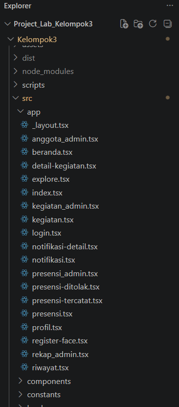

# Dokumentasi Perbaikan UTS — Absensi Pintar

## 2. Perbaikan yang Telah Dilakukan

### 2.1. Rename File Berakhiran `fix.tsx`
**Status: Selesai**

Seluruh file yang sebelumnya menggunakan akhiran `fix.tsx` telah diubah menjadi nama file final yang lebih rapi dan sesuai dengan fungsinya. Perubahan ini dilakukan agar struktur proyek lebih profesional dan siap untuk dipresentasikan.

### 2.2. Pengujian pada Emulator Mobile
**Status: Sedang Berjalan**

Pengujian aplikasi pada emulator mobile masih dalam proses. Pengujian perlu dilakukan menggunakan lingkungan Expo dan emulator mobile yang sesuai, bukan hanya mengandalkan tampilan berbasis web.

Saat ini, proses pengujian terkendala kebutuhan upgrade ke **SDK 58**. Setelah proses upgrade selesai, aplikasi akan diuji kembali untuk memastikan seluruh fitur berjalan dengan baik pada perangkat mobile.

