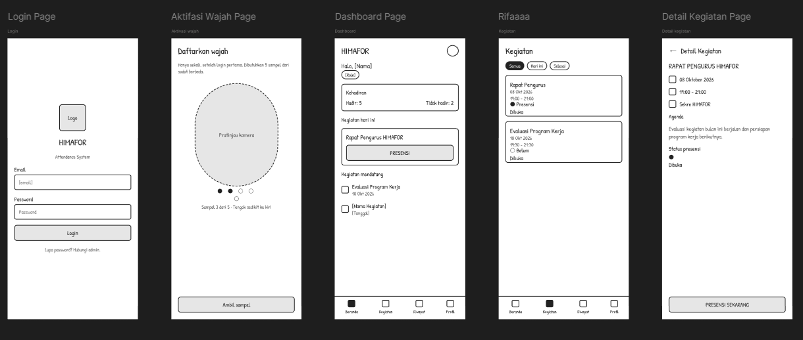
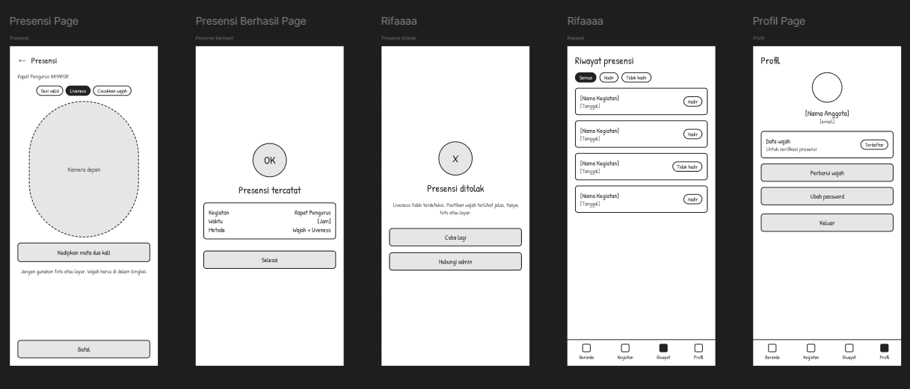
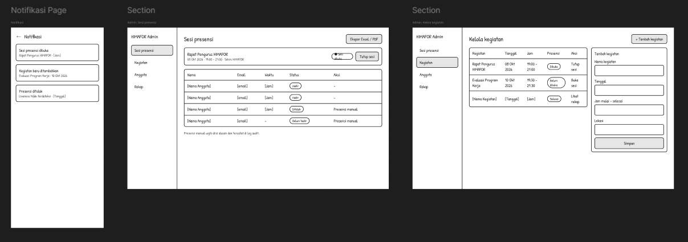
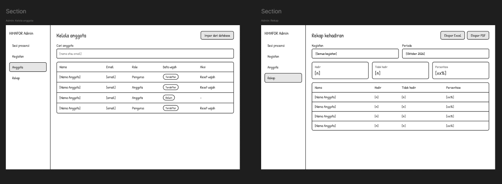

# Proses Pengembangan 2 #
# ABSENSI PINTAR HIMAFOR

## 1. Deskripsi Aplikasi
**Absensi Pintar HIMAFOR** merupakan aplikasi absensi digital yang dirancang untuk membantu proses pencatatan kehadiran anggota HIMAFOR dalam kegiatan organisasi. Aplikasi ini menyediakan antarmuka untuk melakukan login, aktivasi wajah, melihat informasi kegiatan, melakukan presensi, memeriksa riwayat kehadiran, serta mengelola profil dan notifikasi.
Aplikasi ini juga menyediakan halaman admin untuk membantu pengelolaan data dan kebutuhan administrasi sistem absensi.
Pengembangan aplikasi berfokus pada kemudahan penggunaan, tampilan antarmuka yang mudah dipahami, dan proses presensi yang lebih praktis.

### Hasil wawancara
#### Pembukaan

S: Halo Irwan, makasih ya sudah mau ngobrol. Kami lagi mengembangkan aplikasi presensi untuk kegiatan HIMAFOR. Sebelum cerita soal aplikasinya, kami mau dengar pengalaman kamu dulu. Santai saja, nggak ada jawaban benar atau salah.

Irwan: Siap, santai.

S: Di HIMAFOR kamu sebagai apa, dan seberapa sering ikut kegiatan?

Irwan: Aku anggota, sekarang di proker IT Fair sebagai sekretaris pelaksana. Hampir tiap minggu ada rapat atau kegiatan, kadang sampai dua kali.
Kebiasaan dan masalah presensi

S: Biasanya presensi di kegiatan itu gimana?

Irwan: Masih kertas. Daftar hadir diedarkan, terus tanda tangan. Kalau rapatnya ramai, daftarnya muter dari ujung ke ujung, kadang sampai rapat selesai belum balik ke sekretaris.

S: Pernah ada kendala?

Irwan: Banyak. Pernah daftar hadirnya kena air minum, tintanya luntur, jadi susah dibaca. Pernah juga ketinggalan di sekre dan hilang. Yang datang telat juga nggak kelihatan datangnya jam berapa, karena cuma tanda tangan.

S: Terus rekap kehadirannya gimana?

Irwan: Itu yang bikin pusing pengurus. Sekretaris harus ngetik ulang semuanya ke Excel satu-satu. Kalau mau tahu siapa yang kehadirannya kurang dari batas, harus dihitung manual. Pernah dua minggu baru jadi.

S: Kami juga mau tanya hal yang agak sensitif, nggak perlu sebut nama ya. Kamu pernah lihat atau dengar presensi yang dititipkan?

Irwan: Jujur, ada. Biasanya cuma bilang, “Tolong tandatanganin ya, aku telat dikit.” Niatnya bukan jahat, tapi akhirnya data kehadiran nggak bisa dipercaya. Yang rajin hadir jadi merasa nggak adil.

S: Kamu sendiri pakai HP buat urusan organisasi seperti apa?

Irwan: Hampir semuanya lewat HP. Info rapat dari grup WhatsApp, tugas lewat Drive. Kamera depan sih sering dipakai, tapi HP-ku bukan yang kamera bagus banget.

#### Solusi yang ditawarkan

S: Rencana kami, presensi dilakukan lewat HP dengan verifikasi wajah. Menurut kamu gimana?

Irwan: Kedengarannya praktis. Tapi langsung kepikiran: kalau cuma wajah, bisa nggak pakai foto temen?

S: Itu sebabnya ada liveness. Anggota diminta kedipkan mata dua kali, jadi foto atau layar HP nggak akan lolos.

Irwan: Oh, masuk akal. Berarti nggak bisa titip lagi. Tapi gimana kalau cahayanya kurang? Rapat kita sering di tempat yang agak gelap.

S: Itu catatan penting. Sekarang kita lihat tampilannya ya. Mulai dari login.

Irwan: Ada pilihan Pengguna dan Admin, jelas sih. Tapi kalau aku juga lagi bantu jadi pengurus, aku pilih yang mana? Mungkin perlu penjelasan kecil.

S: Lanjut ke daftar wajah. Di sini anggota ambil 5 sampel dari sudut berbeda.

Irwan: Tulisan “hanya sekali” itu bagus, jadi aku tahu nggak akan diulang terus. Instruksi “tengok sedikit ke kiri” juga membantu. Tapi kalau gagal di sampel ketiga, tolong kasih tahu kenapa, jangan cuma gagal begitu saja.

S: Ada kekhawatiran soal data wajah?

Irwan: Ada. Wajahku disimpan di mana, dan siapa yang bisa lihat? Kalau cuma untuk presensi aku oke, tapi harus ada penjelasannya.

S: Rencana kami, yang dipakai hanya untuk verifikasi presensi, dan admin tidak melihat wajah anggota. Admin hanya bisa mereset data wajah kalau ada masalah.

Irwan: Nah, penjelasan seperti itu sebaiknya ditulis di aplikasinya juga, supaya anggota lain nggak curiga.

S: Sekarang dashboard dan presensinya.

Irwan: Aku suka ringkasan hadir dan tidak hadir di atas. Jadi aku bisa cek kehadiranku sendiri tanpa tanya sekretaris. Tombol PRESENSI di kegiatan hari ini juga jelas. Di halaman kegiatan, label “Dibuka” dan “Belum dibuka” berguna, jadi aku nggak buang waktu menekan tombol sebelum sesinya dibuka.

S: Kalau presensinya ditolak, tampilannya begini.

Irwan: Pesannya jelas, nggak terkesan menyalahkan. Tombol “Coba lagi” harus cepat, soalnya kalau gagal terus aku bisa telat. “Hubungi admin” juga bagus buat jaga-jaga.

S: Riwayat presensinya?

Irwan: Filter “Tidak hadir” berguna. Aku bisa cek kegiatan mana yang bolos sebelum ditanya pengurus.

#### Sisi admin

S: Kamu kan sering bantu sekretaris. Ini tampilan admin: buka dan tutup sesi, daftar anggota, rekap, dan ekspor.

Irwan: Ini yang paling dibutuhkan. Buka dan tutup sesi penting supaya orang nggak presensi dari luar rapat. Rekap otomatis dengan persentase juga hemat banget, tinggal ekspor ke Excel atau PDF.

S: Ada yang kurang menurut kamu?

Irwan: Dua hal. Pertama, kalau ada anggota yang HP-nya rusak, kehabisan baterai, atau wajahnya terus gagal, harus ada cara admin mencatat kehadirannya manual. Kedua, kadang sinyal di sekre jelek, jadi sebaiknya jelas apa yang terjadi kalau presensinya nggak terkirim.

#### Penutup

S: Kalau aplikasi ini jadi, kamu mau pakai?

Irwan: Mau banget, asal cepat. Kalau presensi lebih dari satu menit, aku bakal malas. Kalau ada notifikasi pengingat sebelum kegiatan dan sesi dibuka, itu bonus.

S: Makasih banyak, Irwan.

#### Dokumentasi wawancara
 - <video controls src="wawancara.mp4" title="Title"></video>
 - 

### Tujuan Aplikasi
- Mempermudah anggota HIMAFOR dalam melakukan presensi kegiatan.
- Menyediakan informasi kegiatan dalam satu aplikasi.
- Memudahkan anggota melihat riwayat kehadiran.
- Menyediakan informasi status presensi, baik berhasil maupun ditolak.
- Mendukung pengelolaan data absensi melalui halaman admin.

## 2. Daftar Screen dan Fitur UI
1. Admin: Halaman pengelolaan dan administrasi sistem.
2. Login: Form login dan tombol masuk ke aplikasi.
3. Aktivasi Wajah: Antarmuka aktivasi atau pendaftaran wajah.
4. Dashboard: Tampilan utama dan ringkasan informasi aplikasi.
5. Kegiatan: Halaman daftar kegiatan HIMAFOR.
6. Detail Kegiatan: Halaman informasi lengkap kegiatan yang dipilih.
7. Presensi: Antarmuka untuk melakukan presensi kegiatan.
8. Presensi Berhasil: Halaman konfirmasi presensi berhasil.
9. Presensi Ditolak: Halaman informasi presensi ditolak atau tidak berhasil.
10. Riwayat: Halaman daftar dan informasi riwayat kehadiran.
11. Profil: Halaman informasi dan pengelolaan profil pengguna.
12. Notifikasi: Halaman pemberitahuan terkait kegiatan dan presensi.

## 3. Pembagian Tugas Anggota Kelompok
Pembagian tugas pengembangan antarmuka aplikasi Absensi Pintar HIMAFOR adalah sebagai berikut.

### 3.1 Arif — Admin
Bertanggung jawab mengembangkan seluruh halaman admin, termasuk tampilan pengelolaan data dan komponen administrasi sesuai kebutuhan aplikasi.

### 3.2 Rafi — Login, Aktivasi Wajah, dan Presensi Berhasil
Bertanggung jawab mengembangkan:
- Halaman login.
- Halaman aktivasi wajah.
- Halaman status presensi berhasil.

### 3.3 Intan — Dashboard dan Detail Kegiatan
Bertanggung jawab mengembangkan:
- Halaman dashboard sebagai tampilan utama aplikasi.
- Halaman detail kegiatan yang menampilkan informasi lengkap kegiatan.

### 3.4 Rifa — Kegiatan, Presensi Ditolak, dan Riwayat
Bertanggung jawab mengembangkan:
- Halaman daftar kegiatan.
- Halaman status presensi ditolak.
- Halaman riwayat kehadiran.

### 3.5 Ummu — Presensi, Profil, dan Notifikasi
Bertanggung jawab mengembangkan:
- Halaman presensi untuk proses kehadiran.
- Halaman profil pengguna.
- Halaman notifikasi aplikasi.

## 4. Screenshot Setiap Screen
Bagian ini digunakan untuk mendokumentasikan tampilan antarmuka aplikasi yang telah dikembangkan. Masukkan screenshot aktual dari aplikasi untuk setiap halaman dan berikan keterangan singkat mengenai fungsi halaman serta nama penanggung jawabnya.

### 4.1 Admin
**Penanggung jawab:** Arif

Keterangan: Halaman admin untuk pengelolaan dan administrasi aplikasi Absensi Pintar HIMAFOR.

### 4.2 Login
**Penanggung jawab:** Rafi
### 4.3 Aktivasi Wajah
Keterangan: Halaman untuk melakukan aktivasi atau pendaftaran wajah sebagai bagian dari mekanisme presensi.

Keterangan: Halaman login yang digunakan pengguna untuk masuk ke aplikasi.

### 4.4 Dashboard
**Penanggung jawab:** Intan

Keterangan: Halaman utama yang menampilkan ringkasan informasi dan akses menuju fitur aplikasi.

### 4.5 Kegiatan
**Penanggung jawab:** Rifa

Keterangan: Halaman yang menampilkan daftar kegiatan HIMAFOR.

### 4.6 Detail Kegiatan
**Penanggung jawab:** Intan

Keterangan: Halaman yang menyajikan informasi lebih lengkap mengenai kegiatan yang dipilih.

### 4.7 Presensi
**Penanggung jawab:** Ummu

Keterangan: Halaman yang digunakan pengguna untuk melakukan proses presensi kegiatan.

### 4.8 Presensi Berhasil
**Penanggung jawab:** Rafi

Keterangan: Halaman konfirmasi ketika proses presensi berhasil dilakukan.

### 4.9 Presensi Ditolak
**Penanggung jawab:** Rifa

Keterangan: Halaman informasi ketika presensi ditolak atau tidak dapat diselesaikan.

### 4.10 Riwayat
**Penanggung jawab:** Rifa

Keterangan: Halaman yang menampilkan catatan kehadiran pengguna pada kegiatan sebelumnya.

### 4.11 Profil
**Penanggung jawab:** Ummu
### 4.12 Notifikasi
Keterangan: Halaman yang menampilkan pemberitahuan terkait kegiatan dan informasi presensi.

Keterangan: Halaman yang menampilkan informasi profil pengguna.

## 6. Cara Menjalankan Proyek
Langkah berikut merupakan template umum. Sesuaikan dengan jenis proyek dan teknologi yang digunakan.
1. Pastikan perangkat telah memiliki tools atau runtime yang dibutuhkan proyek.
2. Unduh atau clone repositori proyek dari GitHub.
3. Buka folder proyek menggunakan editor kode.
4. Instal dependensi yang diperlukan apabila proyek menggunakannya.
5. Atur konfigurasi database atau variabel lingkungan apabila diperlukan.
6. Jalankan aplikasi menggunakan perintah atau server yang sesuai dengan teknologi yang digunakan.
7. Buka alamat lokal aplikasi melalui browser.
8. Uji setiap halaman untuk memastikan tampilan dan navigasi berjalan sesuai rancangan.
## VIDEO DEMO
https://github.com/user-attachments/assets/fd8228e1-6c30-4eee-9b58-020e2dbf2d85
## Sketch App ##

### Demo APP
- <video controls src="DEMO-1.mp4" title="Title"></video>